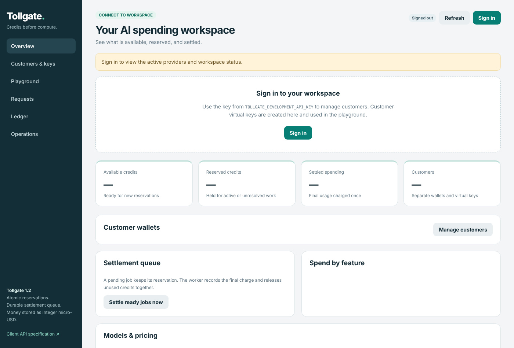
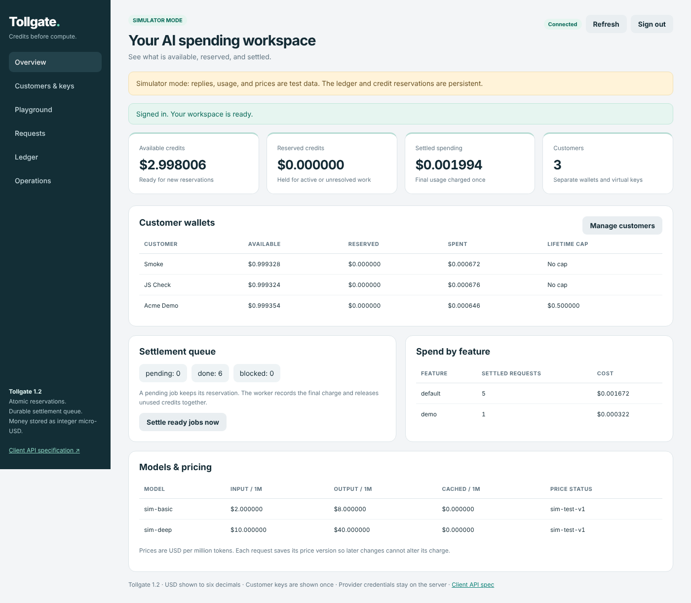
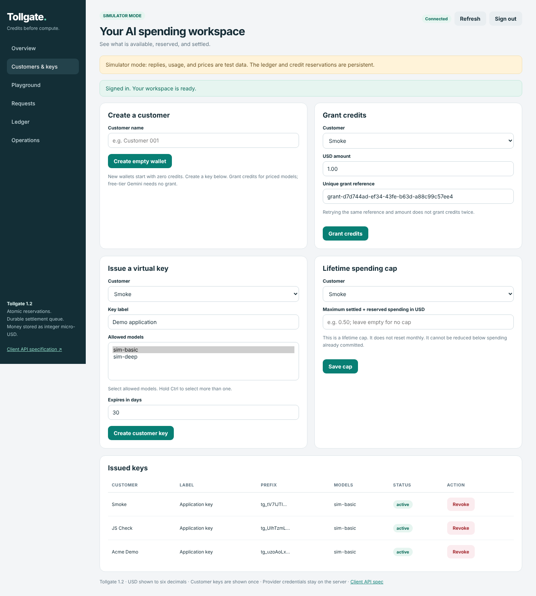
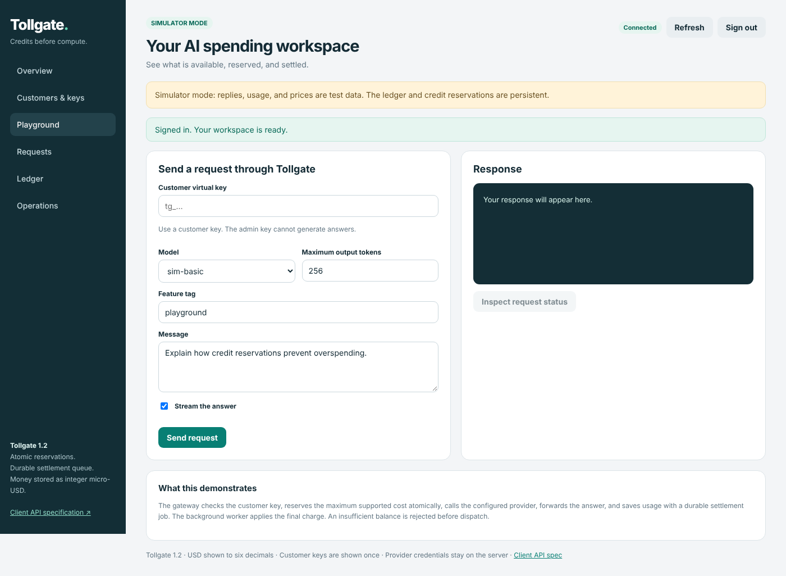
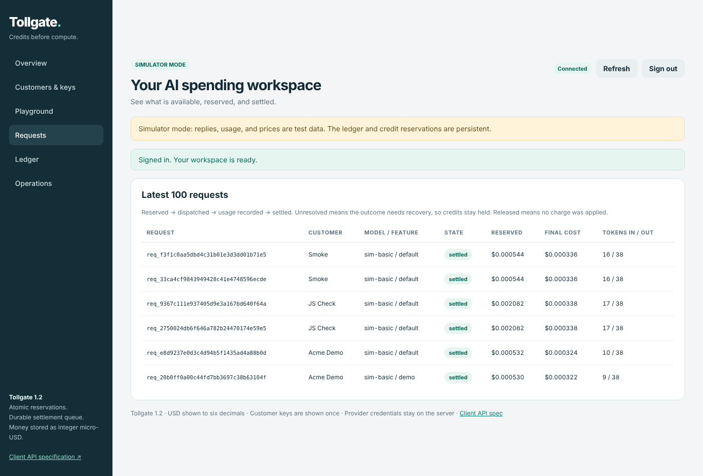
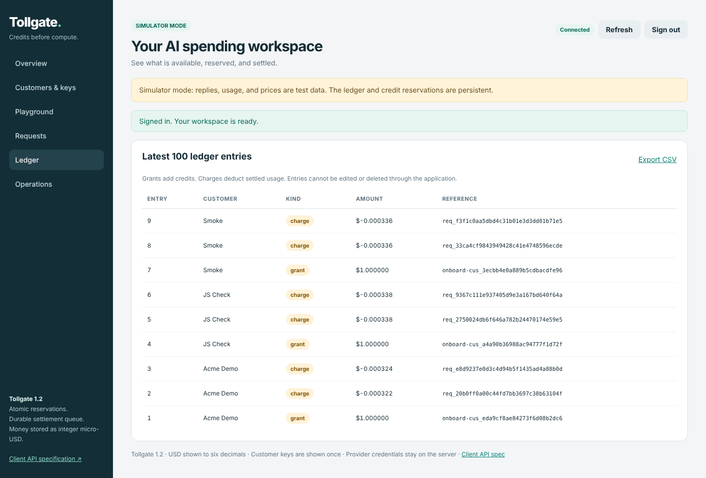
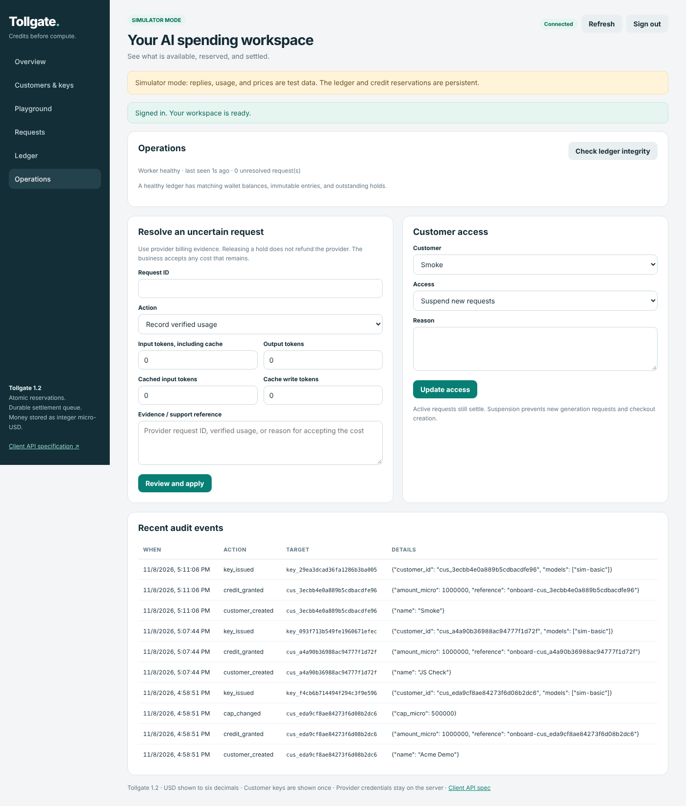

# Admin Panel (operator dashboard)

The admin panel is for **the Tollgate operator only**. Clients never see it. They get a customer API key and the client pack (`docs/ONBOARDING.md`).

## Signing in

1. Open the gateway's public origin in a browser, for example `https://tollgate.example.com/`. It must be **exactly** `TOLLGATE_PUBLIC_ORIGIN`. Sign-in checks the browser's `Origin` header and refuses other addresses.
2. Click **Sign in** and paste the **owner key**. On the server, `python manage.py admin-key` prints it.
3. You get an 8-hour session (`TOLLGATE_SESSION_HOURS`). The session is an HttpOnly, `SameSite=strict` cookie, and `Secure` on HTTPS. Every change you make also carries a CSRF token. The owner key is never stored in the browser.



Sign-in attempts are limited (20 per minute). Admin API calls are limited to 300 per minute. A customer `tg_` key is always refused on admin endpoints (401).

To rotate the owner key, run `python manage.py rotate-admin-key`, then restart every gateway process. Old sessions stop working.

## Sections

### Overview
Totals across all customers (available, reserved, settled), each customer's wallet, the settlement queue, spend by feature label, and model prices with their price version.

- **Settle ready jobs now** runs settlement immediately. The worker normally does this within a second.
- `blocked` jobs in the queue need attention (see Operations).



### Customers & keys
- **Create a customer**: an empty wallet. No money is granted automatically.
- **Grant credits**: amount in USD plus a unique reference. The same reference and amount is never added twice.
- **Issue a virtual key**: choose allowed models and an expiry. The full key appears **once**, so copy it there and then.
- **Lifetime spending cap**: a hard ceiling on settled + reserved spending.
- **Issued keys**: prefix, models, status (active, expired or revoked), and **Revoke**.



### Playground
Send a test request **with a customer key**, exactly as a client would. Use it to check a new key or model. Then **Inspect request status** shows the request's state and cost.



### Requests
The latest 100 requests: customer, model, feature, state, tokens, reservation, final cost, error code. Prompts and answers are never stored, so they are never shown.



### Ledger
The latest 100 ledger entries. Grants are positive and charges negative. Ledger rows are immutable: in PostgreSQL the runtime database role cannot update or delete them. Full export: `GET /admin/ledger.csv`, which is protected against spreadsheet formula injection.



### Operations
- **Wardens and Patrol**: in multi-node deployments, each API node's status (online, offline or draining) and Patrol's findings.
- **Check ledger integrity**: proves that every wallet equals grants minus charges, and every hold matches open requests.
- **Resolve an uncertain request**: for `unresolved` requests, where the provider's result could not be confirmed. Check the provider's console first, then either **Record verified usage** (tokens + evidence) or **Release hold with evidence**. Every resolution is audited. See `docs/OPERATIONS.md` → Unknown request procedure.
- **Customer access**: **Suspend new requests** or **Restore access**, with a reason.
- **Recent audit events**: every customer, key, credit, cap, freeze and resolution action.



## How the admin panel is kept apart from the client API

| | client API | admin panel |
|---|---|---|
| Paths | `/v1/*`, `/health`, `/ready`, `/api-spec.json` | `/`, `/admin/*`, `/auth/*` |
| Credential | customer key `tg_...` (hashed in the database) | owner key, or a dashboard session |
| What a credential can see | only its own customer's balance and requests | everything |

There are two levels of separation:

1. **In one process** (`compose.yaml`): the authentication middleware refuses customer keys on `/admin/*` and the owner key on `/v1/*`. There is no shared token type.
2. **As separate services** (`compose.wardens.yaml`): `TOLLGATE_SERVICE_ROLE` splits the same code into a **control** service (dashboard + admin, no generation) and **warden** services (`/v1` only, no admin). A warden returns 404 `wrong_service` for `/admin/*`, and control returns it for `/v1/*`. The load balancer sends `/v1/*` to wardens and everything else to control. This was verified with a control node, two wardens, a worker and Patrol on PostgreSQL (`docs/READINESS.md`).

For extra protection you can restrict `/`, `/admin/*` and `/auth/*` to your own IP address at the edge. See `docs/DEPLOYMENT.md` §6.

## Everything is also an API

Every dashboard action calls an `/admin/*` endpoint with the owner key, so the same work can be scripted:

```bash
OWNER="Authorization: Bearer $(python manage.py admin-key)"
curl -X POST $BASE/admin/customers -H "$OWNER" -H "Content-Type: application/json" -d '{"name":"Acme"}'
curl -X POST $BASE/admin/credits   -H "$OWNER" -H "Content-Type: application/json" -d '{"customer_id":"cus_...","amount_usd":"5.00","reference":"inv-1001"}'
curl -X POST $BASE/admin/keys      -H "$OWNER" -H "Content-Type: application/json" -d '{"customer_id":"cus_...","label":"prod","allowed_models":["gemini-3.5-flash-lite"],"expires_in_days":30}'
curl -X DELETE $BASE/admin/keys/key_... -H "$OWNER"
curl -X PUT  $BASE/admin/spend-cap -H "$OWNER" -H "Content-Type: application/json" -d '{"customer_id":"cus_...","amount_usd":"20.00"}'
curl -X POST $BASE/admin/customers/cus_.../freeze -H "$OWNER" -H "Content-Type: application/json" -d '{"frozen":true,"reason":"unpaid invoice"}'
curl $BASE/admin/overview -H "$OWNER"
curl $BASE/admin/reconciliation -H "$OWNER"
```

`python manage.py onboard` does the first three in one step and prints the client pack.
