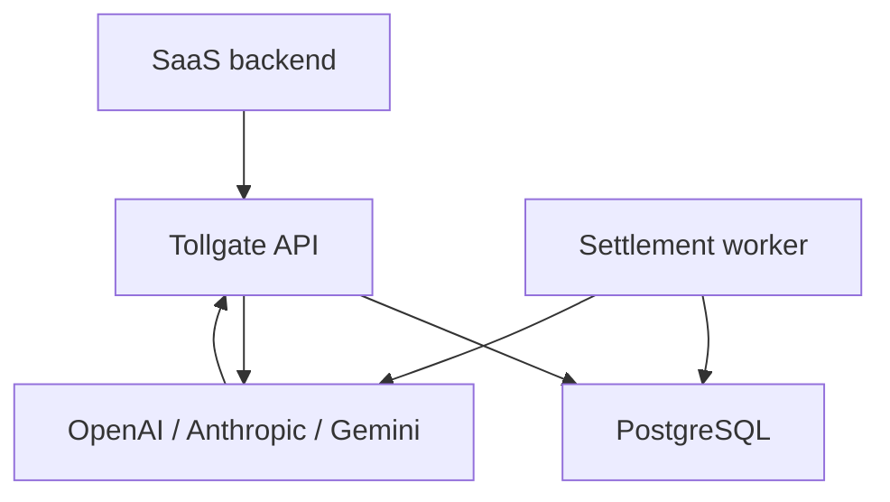
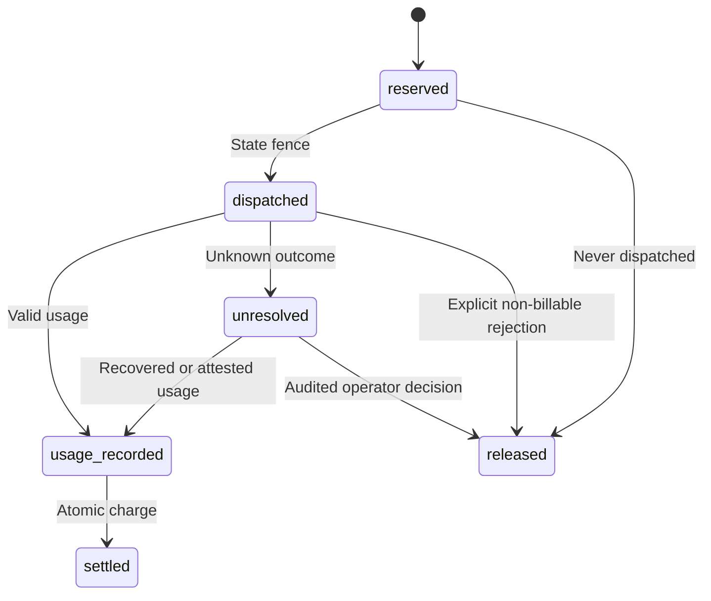

# Architecture and correctness

## Warden update in version 1.1

The same application now runs as `standalone`, `control`, or `warden` in separate processes. Control serves administration and the dashboard; warden serves the customer API and calls providers directly. The credit ledger remains the shared authority. Control-process downtime does not interrupt funded customer generation under `fail_open` while the database and settlement worker remain available. This does not provide offline operation when the ledger fails.

Wardens persist request metadata, token counts, prices, and accounting state in the shared database. Control reads these records as a monitoring mirror. No duplicate generation or prompt/answer copying occurs. There is no separate asynchronous financial mirror in this release.

`cluster.py` stores process leases using the database clock. A warden rechecks its lease, drain flag, control policy, and worker attendance inside the reservation transaction. Replaced or expired processes cannot reserve more credits. Five-second heartbeats expire after twenty seconds by default. `patrol.py` independently reports stale or missing nodes, stale worker activity, and unresolved usage. Patrol does not settle money or resubmit generation.

HAProxy probes `/ready` and selects a healthy warden. The supplied configuration disables request replay. A broken stream cannot move to another process. Shared dependencies still include the database, ingress, host/network, and provider. See [WARDENS.md](WARDENS.md) for policies, Windows commands, and staged deployment checks. The remainder describes the accounting core used by both standalone and warden roles.

## Services

The API accepts the supported Chat Completions contract. Provider adapters count input and normalize streamed output. A database holds customer wallets, key hashes, request state, immutable ledger entries, pending settlements, sessions, rate windows, payment orders, and audit events. A worker settles pending jobs and attempts bounded recovery. The browser is an operator console, not the source of financial truth.

## One request

1. Authenticate a customer key before parsing the request body. Apply a database-backed customer rate limit.
2. Validate supported fields, model access, output limits, and price freshness. Count input through the configured provider. Counting does not dispatch generation.
3. Inside one short write transaction, recheck key expiry/revocation, idempotency, wallet suspension, available balance, lifetime cap, and concurrency. Increase held credits and insert the reserved request with rate snapshots.
4. Change reserved to dispatched using a state fence before network I/O. An expired/released reservation cannot dispatch later.
5. Call the provider once. Capture its response ID early. Forward text incrementally. JSON clients also consume a streamed provider response internally.
6. Persist final usage and a settlement job together before emitting final usage to the customer.
7. The worker inserts one ledger charge, decreases the wallet balance, releases the entire hold, updates lifetime spending, and finishes the job in one transaction. The state transition makes repeated worker attempts no-ops.

Reported usage exceeding the reserved token/cost bound is recorded but blocked. It cannot silently overdraw the wallet. An operator can release a hold only with evidence, accepting any unrecovered provider cost. There is no automatic second generation to replace an unknown outcome.

## Invariants

- Available credits = posted balance − held credits; neither can be negative.
- Posted balance equals the sum of immutable ledger entries.
- Held credits equal reservations in reserved, dispatched, unresolved, and usage-recorded states.
- A settlement can create at most one charge for a request.
- Price changes do not change existing request snapshots.
- A customer key cannot inspect another customer's request or access owner endpoints.
- Provider timeout is not evidence that generation was free.
- Exactly-once internal accounting is not a guarantee of exactly-once execution by an external provider.

## Storage and concurrency

SQLite uses rollback journaling and synchronous FULL for local learning. Production requires PostgreSQL. Both serialize short financial writes: BEGIN IMMEDIATE on SQLite and a transaction-scoped PostgreSQL advisory lock shared by every process on that database. Network calls never run inside these transactions.

This conservative first release favors auditable correctness. The PostgreSQL write lock is **global to the deployment**, not per customer. It limits write throughput. No throughput/SLA claim is made. Load-test your workload before rollout; a future version can replace it with ordered wallet/request row locks while keeping these invariants and concurrency tests. Adding API replicas does not remove this write bottleneck.

Read paths use bounded dashboard lists (200 customers/keys and 100 requests/ledger/audit rows). Aggregate totals cover all wallets. CSV export is bounded to 10,000 ledger entries per page; use the `X-Next-Before` header as the next `before` query parameter. The current dashboard is intended for a small SaaS operator, not unbounded analytics.

## State retained

The gateway does not persist prompt or answer content. It retains metadata, token usage, request fingerprint, provider response ID, money movements, and operator evidence. Request fingerprints are SHA-256 of the canonical request plus feature tag; they are not encrypted content. Keep database access restricted. Operator evidence must not contain secrets or prompt text.

OpenAI response storage is opt-in because retrieval requires provider-side retention. A lost ID still prevents automated recovery. Anthropic and Gemini have no equivalent retrieval mechanism implemented in these adapters; unresolved outcomes require provider/account evidence.

Gemini's free-tier adapter follows the same durable state transitions with $0 reservations and charges. Native token counting enforces the input limit. Final cumulative usage is accepted only after a clean stream end and is never summed across chunks. Output usage includes visible and thinking tokens, checked against the reviewed model ceiling. A zero-cost request cannot demonstrate paid balance enforcement; simulator tests exercise that behavior. The gateway cannot infer a Google project's billing tier from its key.

## Keys

The owner key configures one operator account and can access all customer administration APIs. A browser exchanges it for a revocable, expiring session. Customer keys have their own hashes, model permissions, and optional expiry. Provider keys are server configuration only. Owner key rotation requires restarting all API processes; sessions tied to the old key hash then fail validation.
