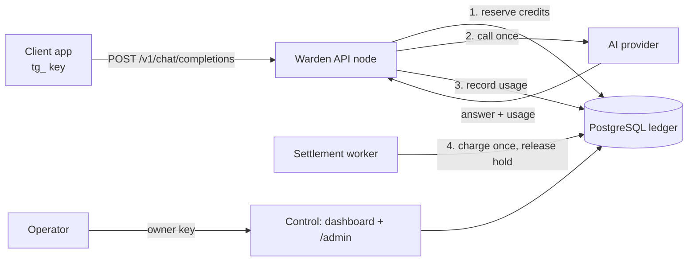

# Tollgate 1.2 — Project Handover

**Student:** Sohaib Sajid (BSAI24043), Information Technology University, Lahore
**Project:** Tollgate, a prepaid AI API gateway and credit manager

---

## 1. The problem

Businesses that add AI features to their products face three problems:

1. **Key sprawl.** Every application holds the company's real AI provider key. If one leaks, everything is exposed.
2. **Uncontrolled cost.** Providers bill after the fact. A bug or an abusive user can spend far beyond a customer's budget before anyone notices.
3. **No per-client accounting.** It is hard to say exactly what each client consumed, at what price, and to bill it correctly once.

## 2. The solution

Tollgate sits between client applications and AI providers (OpenAI, Anthropic, Google Gemini).

- Each client gets its own **virtual API key** (`tg_...`), never the provider key.
- Before every request Tollgate **reserves** the worst-case cost from the client's prepaid credits. If the credits can't cover it, the request is refused before any money is spent.
- It calls the provider **once**, records the exact reported usage, and a separate worker **settles the charge exactly once**, then returns the unused reservation.
- Money is stored as integer micro-dollars. The ledger can't be edited (enforced by database permissions in production).
- The client endpoint is **OpenAI-compatible**, so existing code needs only a new `base_url` and key.



## 3. How the brief is met

| # | requirement | how Tollgate meets it | where |
|---|---|---|---|
| 1 | Clean, well-defined endpoints a client can plug into | Six client operations under one strict, OpenAI-compatible contract. One error envelope, request IDs on every response, unknown fields rejected. | `docs/api/openapi.json` |
| 2 | Repeatable onboarding without back-and-forth | One command creates the customer, funds it, issues a restricted key and prints a **client pack**. The client gets the pack, the spec and the guide, and nothing else. | `python manage.py onboard`, `docs/ONBOARDING.md` |
| 3 | Authentication: a token per client | Per-client `tg_` keys, stored only as hashes, with model allow-lists, expiry, revocation, spend caps and freezing | `docs/API_GUIDE.md` §3, `docs/ONBOARDING.md` §4–8 |
| 4 | Separate admin panel; clients only get credentials | Operator dashboard and `/admin` API use a separate owner key and sessions. Customer keys are refused there. In the multi-node deployment the admin panel is a **separate service** from the client API. | `docs/ADMIN_PANEL.md` |
| 5 | The deliverable is the complete REST API specification | OpenAPI 3.1 document covering every client operation, schema, header and 31 error codes with examples. It is also served live at `/api-spec.json`. | `docs/api/openapi.json` |
| 6 | Documentation that scales to 100 integrators tomorrow | A self-serve integration guide (5-minute quick start in curl, Python and JavaScript, streaming, retries, error table, limits, FAQ, versioning policy). **The spec and the guide are generated from the same code and checked by tests**, so they can't drift from the server. | `docs/API_GUIDE.md`, `gateway/tests/test_api_contract.py` |

## 4. Architecture in brief

- **FastAPI** application. **PostgreSQL** in production (SQLite for development).
- **Roles from the same code:** `standalone` (everything), `control` (dashboard and admin), `warden` (client API only). A load balancer spreads `/v1` traffic over wardens and routes only to ready ones.
- **Settlement worker:** a durable queue that charges each request exactly once and survives crashes.
- **Patrol:** an independent monitor of node health and the accounting backlog.
- **Provider adapters:** OpenAI, Anthropic and Gemini, plus a local **simulator** for cost-free testing.
- **Offline continuity:** a standby relay and a client library for when the main system is unreachable (`docs/OFFLINE.md`).

Detail: `docs/ARCHITECTURE.md`, `docs/WARDENS.md`.

## 5. How to test it yourself

From `gateway/` (Python 3.12 or 3.13):

```powershell
python -m pip install -r requirements.txt
python -m unittest discover -s tests          # 122 tests
python manage.py setup --mode simulator
python manage.py migrate
```

Then follow `docs/DEPLOYMENT.md` section A: start the simulator, gateway and worker, run `python manage.py onboard ...`, and use the printed key with the examples in `docs/API_GUIDE.md` §2.

To view the specification, open `docs/api/openapi.json` in <https://editor.swagger.io> (File → Import file).

## 6. Evidence

See `docs/READINESS.md` for the full report, with the verification level of every claim. Highlights:

- **Real Gemini request verified end to end**: answer, provider-reported tokens, settled once, ledger matches.
- **122 automated tests pass**, including a real PostgreSQL concurrency test.
- **18 contract tests** prove the published specification matches the running server: response schemas, headers, every documented error path, streaming format and exactly-once billing.
- **Production-mode run on PostgreSQL** (23/23 checks): docs hidden, host allow-list, HSTS, secure sessions, the ledger can't be modified by the application role, no secrets in logs.
- **Multi-node failure run** (21/21 checks): warden failover with zero failed requests, restarts, draining, control outage, worker crash, database restart, and exactly one charge per request afterwards.
- **Security review** with findings and fixes: `docs/SECURITY.md`.

## 7. Known limits (honest scope)

- Text chat only: no tools, images, audio or embeddings.
- Real provider verified with Gemini's free tier only (`client/live_smoke.py`, 9/9). OpenAI and Anthropic adapters are tested against recorded responses, not live accounts.
- Container images and a public HTTPS deployment are prepared and documented but not yet run.
- Stripe is optional and not usable for a Pakistan-registered business. Credits are granted manually after payment.

## 8. Presentation outline (about 12 minutes)

1. **Problem** (1 min): key sprawl, uncontrolled AI cost, per-client billing.
2. **Solution and architecture** (2 min): the diagram above. Reserve → call once → settle once.
3. **Onboarding live** (2 min): run `manage.py onboard`, show the client pack, explain what the client receives (and what they don't).
4. **Client integration live** (3 min): open `openapi.json` in Swagger Editor. Call `/v1/models`, a chat request with the OpenAI SDK, and a streaming request. Show the cost header.
5. **Admin panel** (2 min): the request appears in Requests and Ledger. Show balance, spend cap, revoke a key, then show the same key getting 401.
6. **Reliability and correctness** (1 min): repeat the request with the same Idempotency-Key and get 409, no double charge. Show the failover results from `READINESS.md`.
7. **Real AI** (1 min): the same flow with Gemini, showing real token counts in the ledger.
8. **Questions.**
